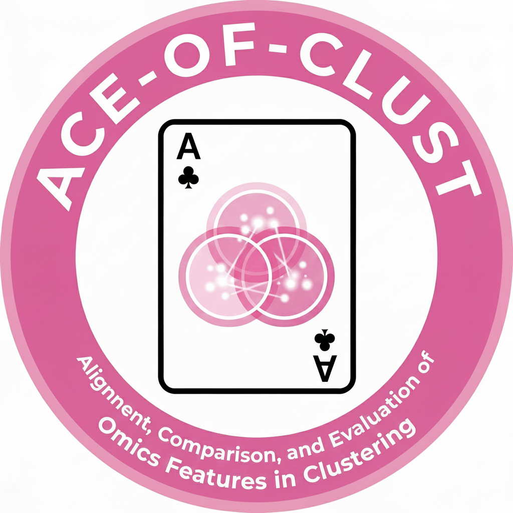

# ACE-OF-Clust
<p align="center">
  
</p>

Tutorials and API reference for `ace_of_clust`. Source on [GitHub](https://github.com/xr-cc/ace-of-clust).

## Installation

Requires Python 3.9–3.11.

```bash
pip install ace-of-clust
```

Optional, to repel overlapping labels in some plots:

```bash
pip install "ace-of-clust[adjusttext]"
```

To run the tutorials, install Jupyter and clone the [repository](https://github.com/xr-cc/ace-of-clust) for the example data.

## Tutorials

- [Quickstart](tutorials/quickstart.ipynb): the minimal steps
- [Toy Example](tutorials/toy_example.ipynb): full walkthrough on simulated data
- [Run Clumppling](tutorials/run_clumppling.md): *Clumppling* and *compModels* on PBMC3k
- [PBMC3k Hard Clustering Example](tutorials/ex1_pbmc3k_hc.ipynb)
- [HBC Spatial Transcriptomics Mixed-Membership Clustering Example](tutorials/ex2_hbc_mmc.ipynb)

## Reference

- [Overview](reference/index.md)
